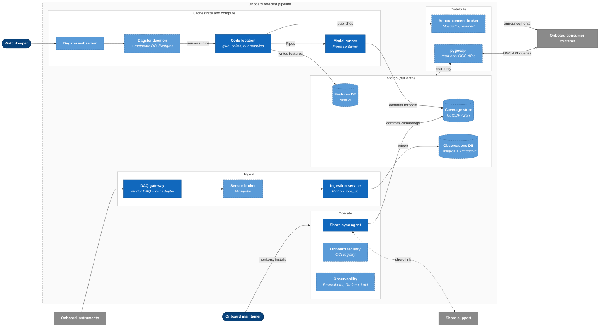
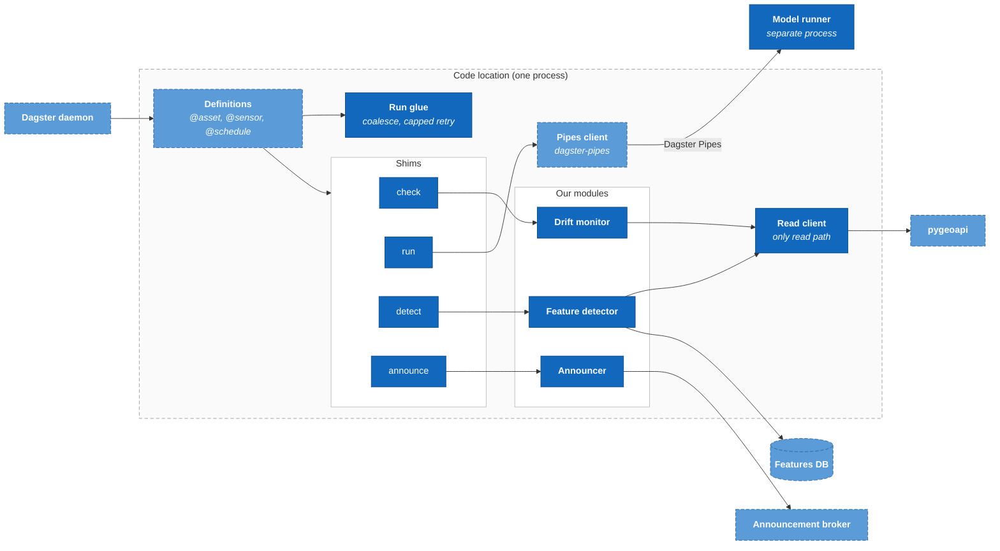
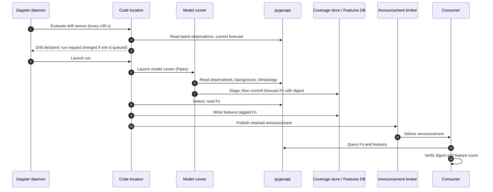
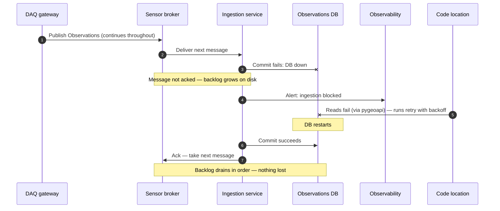
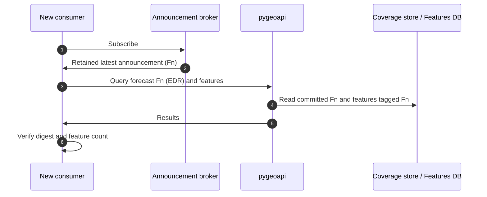
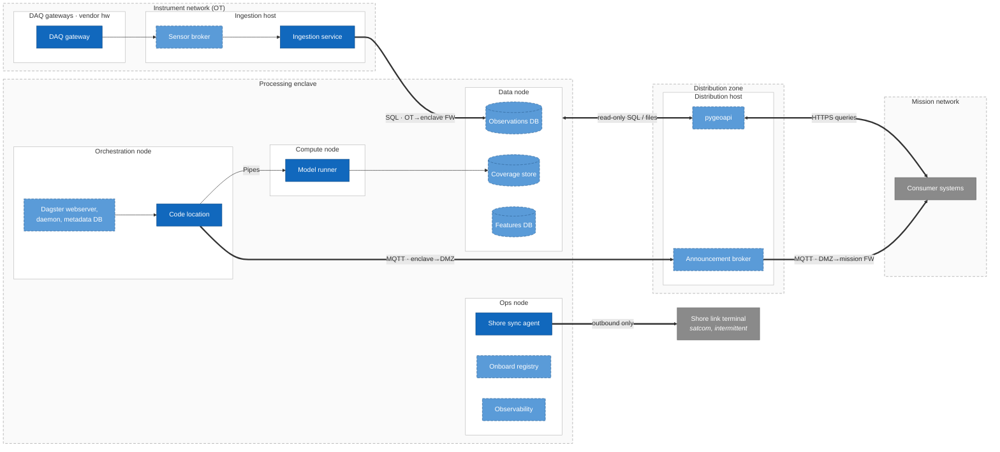
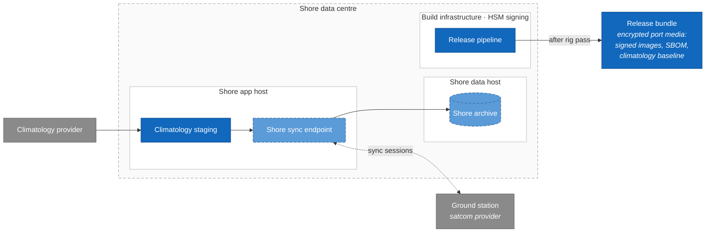
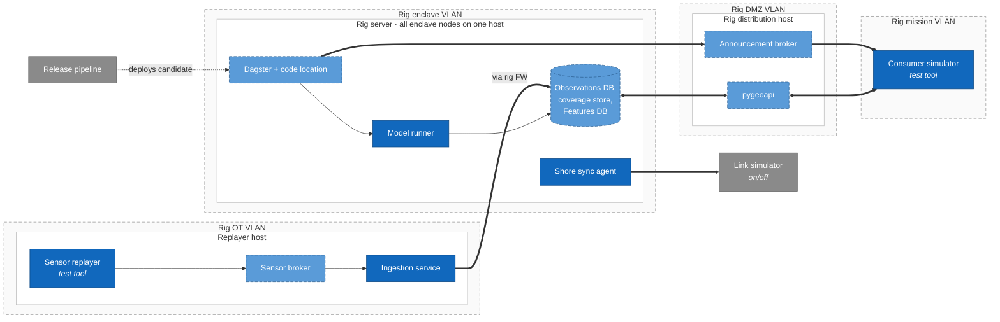

# C4 Model — Production Candidate (Physical View)

Companion to `srd.md` (v2) and `docs/system-architecture.md`. Status: **draft for review (Nov 13, 2026)**.

This is an alternative to `docs/system-architecture.md` §1.2–1.3, kept as a separate document so the two can be compared. It describes the **eventual production system**, not the demonstrator. Like the rest of the architecture material, it is a candidate design, not a commitment.

Diagrams are Mermaid flowcharts styled with C4 conventions, and Mermaid sequence diagrams for the Dynamic views. Both render on GitHub with no tooling. Mermaid's dedicated C4 syntax was tried first and dropped because its layout was unreadable (§8).

| Level | Diagram | Section |
|---|---|---|
| 1 | System Context | §2 |
| 2 | Containers | §3 |
| 3 | Components: code location | §4 |
| — | Dynamic: drift → forecast → announce; ingest outage recovery; late-joiner consumer | §5 |
| — | Deployment: ship, shore, test rig | §6 |

Notation, consistent with SRD §5.3 and `system-architecture.md` §5.4:

- **Dark blue, solid border:** ours (build). **Light blue, dashed border:** adopted (off the shelf). **Grey:** external system. **Navy rounded:** person. **Cylinder:** data store. **Dashed grey frame:** system boundary or network zone. **Thick arrow:** crosses a zone boundary.

- **Ours (build):** element names without a product. For example, "Ingestion service".
- **Adopted (off the shelf):** the candidate product and licence are given in the technology field. For example, "Mosquitto, EPL-2.0".
- Stores are adopted products that hold **our data and schemas** (§5.3 of the architecture doc).

---

## 1. Scope and assumptions

Carries forward assumptions A1–A4 (`system-architecture.md` §1.1), and adds the following, decided in the interview of Nov 13, 2026:

| # | Decision |
|---|---|
| C1 | Model the production system only. The demonstrator already projects it (SYS-1–6). |
| C2 | Levels: Context, Container, Component (code location only), Dynamic (three flows), Deployment. No Code level. |
| C3 | Three deployment environments: **ship** (production), **shore**, and a **shore test rig**. |
| C4 | Onboard hosts are **logical deployment nodes, unsized**. They may share hardware. Sizing is an open question (§7). |
| C5 | The shore link carries **climatology updates** (shore → ship) and **data back to shore** (ship → shore). It does not carry software or remote monitoring. |
| C6 | Software reaches the ship on **physical media in port**: signed images and an SBOM, loaded into an onboard registry. |
| C7 | The test rig is an **integration mirror**: the same container set and zones on smaller hardware, with a sensor replayer in place of real instruments. Release images are validated here before they are written to port media. |
| C8 | Actors: **watchkeeper/forecaster**, **onboard maintainer**, **shore analyst**. |

---

## 2. Level 1 — System Context

Two software systems are in scope. One is the **onboard forecast pipeline**. The other is **shore support**, which is new in this document: it distributes climatology, receives returned data, and builds releases.

---

## 3. Level 2 — Containers

### 3.1 Onboard forecast pipeline

Only the main data relations are drawn. Every service also pulls its image from the onboard registry and exports metrics and logs to observability. Those relations are omitted for legibility.

### 3.2 Shore support

---

## 4. Level 3 — Components of the code location

This diagram is where the import boundary meets the process boundary (`system-architecture.md` §1.4 point 1). Everything below runs in **one process**. The model runner is the only module of ours that is isolated in its own process.

Boundary rules (ARC-1, ARC-7): the drift monitor, feature detector and announcer import neither Dagster nor the shims nor the deployment model. The run glue and the Pipes client are **orchestrator glue**. They are custom code, but they are neither our special sauce nor off the shelf, and they need an owner (`system-architecture.md` §5.3).

---

## 5. Dynamic diagrams

Drawn as sequence diagrams, with numbered steps. A sequence diagram shows order better than C4's numbered-arrow form.

### 5.1 Drift → forecast → announce

A step that fails (5–9) is retried with backoff, up to a cap. After that an alert is raised, and the staleness schedule becomes the recovery path (`system-architecture.md` §1.4 point 4).

### 5.2 Ingest outage recovery

Step 5 is drawn as a direct call for brevity. The real path goes through pygeoapi. The sensor broker's disk must hold the longest DB outage you expect (`system-architecture.md` §1.3).

### 5.3 Late-joiner consumer

---

## 6. Deployment diagrams (the physical view)

### 6.1 Ship — production

The deployment nodes are **logical** (C4). Nodes in the processing enclave may share physical hosts, so the diagram does not size or count servers. Container runtime: Docker Compose or k3s on hardened hosts (A4).

Firewall rules implied by the diagram. Each one should become a test on the test rig (§6.3):

| From → to | Allowed | Purpose |
|---|---|---|
| OT → enclave | Ingestion → Observations DB (SQL) only | Single writer |
| Enclave → OT | None | OT accepts no inbound (A2) |
| Enclave ↔ DMZ | Code location/model runner → pygeoapi; code location → broker; pygeoapi → stores (read-only) | Single read path |
| DMZ → mission | Broker → consumers; consumers → pygeoapi (inbound to DMZ) | Distribution |
| Mission → enclave | **Open question:** watchkeeper → Dagster webserver | See §7 |
| Enclave → shore link | Shore sync agent only, outbound | Data out, climatology in |

### 6.2 Shore

### 6.3 Shore test rig — integration mirror

The test rig has the same zones and the same container set as the ship, on smaller hardware. Two things differ:

- A **sensor replayer** replaces the instruments and DAQ gateways. It publishes recorded or synthetic SensorThings messages to the sensor broker.
- A **consumer simulator** replaces the mission systems. It subscribes, queries and verifies (CON-1–3).

What the rig proves: the release images start; the firewall rules in §6.1 hold (including negative tests); the dynamic flows in §5 work end to end, including DB and ingestion restarts; and shore sync works against a link simulator that can be switched on and off.

What it does not prove: real instrument protocols and the DAQ adapter, production-scale performance, or hardware failover.

---

## 7. Open questions raised by this model

| # | Question | Why it matters |
|---|---|---|
| Q1 | **How does the watchkeeper reach the Dagster webserver?** It sits in the processing enclave, and watchkeepers sit on the mission network. | The options are: open mission → enclave HTTPS for one host (this weakens the zone model); a console inside the enclave; or a small run-request API in the DMZ. |
| Q2 | **Where does shore sync read from?** | Through pygeoapi (consistent with the read-path decision, but slow for bulk transfer), or by direct read-only replication of the stores (efficient, but a second read path). |
| Q3 | **Climatology commit.** The shore sync agent becomes a second writer to the coverage store. | It must use the same staging + manifest-swap commit as the model runner, and must not swap climatology during a run. Who owns that convention? |
| Q4 | **Onboard host sizing and count** (C4). | The model runner and the databases are the likely contention. Decide before buying hardware; the rig can measure it. |
| Q5 | **Port media cadence.** | Security fixes wait for the next port call. Is an emergency path over the link ever acceptable? |
| Q6 | **Rollback onboard.** | The onboard registry should keep the previous release; the maintainer needs a documented rollback. |
| Q7 | **Time sync (PTP/NTP) and backup** are not drawn. | Observation timestamps drive freshness (`system-architecture.md` §1.4 point 6), so time is a correctness dependency, not just operations. |

---

## 8. Critical analysis

- **The physical view is still mostly logical.** Unsized deployment nodes (C4) make the diagrams honest, but they defer the decision a physical view usually exists to make: how many boxes, and what shares a host. Q4 should close before the ship deployment is treated as stable.
- **New containers expand scope.** The shore sync agent, onboard registry, shore support system and test rig are not in the SRD. Each needs an owner, and two of them (sync agent, registry) open new paths across zone boundaries. The sync agent is the first container in the enclave that talks to the outside world. It is the one most likely to be challenged in a security review.
- **Read-path tension.** "pygeoapi is the only read path" was decided for our modules. Data back to shore (Q2) and climatology import (Q3) test that rule from both directions. Either extend the rule explicitly or record the exceptions.
- **Mission access to the orchestrator UI (Q1) conflicts with zone separation.** A watchkeeper actor implies a path that the zone model does not provide today. This is the most important design gap the Context diagram exposes.
- **Mermaid flowcharts are a compromise.** They render on GitHub and lay out far better than Mermaid's C4 mode, but the C4 semantics live only in styling conventions, not in the notation. Some relations are omitted, or drawn to a whole group, to keep the diagrams legible. There is also no single model: the eight diagrams are maintained by hand and can drift from each other, from `system-architecture.md` §1.2 and from `deployment.ts`. If this document is chosen over §1.2, consider Structurizr DSL, or a test that checks container names against `deployment.ts` placements.
- **Naming differs from `deployment.ts`.** "Ops node" and "Shore link gateway" do not exist in the demonstrator, and the demonstrator's "Sea" zone has no production meaning. That is acceptable while the documents are compared, but must be reconciled afterwards.
- **The test rig's blind spot is the edge that fails most.** The replayer bypasses the DAQ adapter and instrument protocols, which are often the least reliable parts at sea. A small bench of real instruments, or vendor simulators, would close that gap.
- **The "ours" vs "adopted" line is clearer here than in the SRD.** The technology field names the product and licence for every adopted container, so licence traps (TimescaleDB edition, PostGIS GPL, avoiding MinIO's AGPL) are visible on the diagrams themselves.
