# C4 Model — Production Candidate (Physical View)

Companion to `srd.md` (v2) and `docs/system-architecture.md`. Status: **draft for review (Nov 14, 2026)**. Open questions Q1–Q7 were decided on Nov 14 (§7).

This is an alternative to `docs/system-architecture.md` §1.2–1.3, kept as a separate document so the two can be compared. It describes the **eventual production system**, not the demonstrator. Like the rest of the architecture material, it is a candidate design, not a commitment.

Diagrams are Mermaid flowcharts styled with C4 conventions, and Mermaid sequence diagrams for the Dynamic views. Both render on GitHub with no tooling. Mermaid's dedicated C4 syntax was tried first and dropped because its layout was unreadable (§8).

| Level | Diagram | Section |
|---|---|---|
| 1 | System Context | §2 |
| 2 | Containers: pipeline; operations and shore transfer; shore support | §3 |
| 3 | Components: code location (forecast pipeline; shore transfer) | §4 |
| — | Dynamic: drift → forecast → announce; ingest outage recovery; late-joiner consumer | §5 |
| — | Deployment: ship, shore, test rig | §6 |

Notation, consistent with SRD §5.3 and `system-architecture.md` §5.4:

- **Dark blue, solid border:** ours (build). **Light blue, dashed border:** adopted (off the shelf). **Grey:** external system. **Navy rounded:** person. **Cylinder:** data store. **Dashed grey frame:** system boundary or network zone. **Thick arrow:** crosses a zone boundary.

- **Ours (build):** element names without a product. For example, "Ingestion service".
- **Adopted (off the shelf):** the candidate product and licence are given in the technology field. For example, "Mosquitto, EPL-2.0".
- Stores are adopted products that hold **our data and schemas** (§5.3 of the architecture doc).

---

## 1. Scope and assumptions

Carries forward assumptions A1–A4 (`system-architecture.md` §1.1), and adds the following, decided in the interview of Nov 13, 2026:

| # | Decision |
|---|---|
| C1 | Model the production system only. The demonstrator already projects it (SYS-1–6). |
| C2 | Levels: Context, Container, Component (code location only), Dynamic (three flows), Deployment. No Code level. |
| C3 | Three deployment environments: **ship** (production), **shore**, and a **shore test rig**. |
| C4 | Onboard hosts are **logical deployment nodes, unsized**. They may share hardware. Sizing is decided by measurement on the test rig (D4). |
| C5 | The shore link carries **climatology updates** (shore → ship) and **data back to shore** (ship → shore). It does not carry software or remote monitoring. |
| C6 | Software reaches the ship on **physical media in port only**: signed images and an SBOM, loaded into an onboard registry. There is no over-the-link path, even for urgent fixes (D5). |
| C7 | The test rig is an **integration mirror**: the same container set and zones on smaller hardware, with a sensor replayer in place of real instruments. Release images are validated here before they are written to port media. |
| C8 | Actors: **watchkeeper/forecaster**, **onboard maintainer**, **shore analyst**. |

---

## 2. Level 1 — System Context

Two software systems are in scope. One is the **onboard forecast pipeline**. The other is **shore support**, which is new in this document: it distributes climatology, receives returned data, and builds releases.

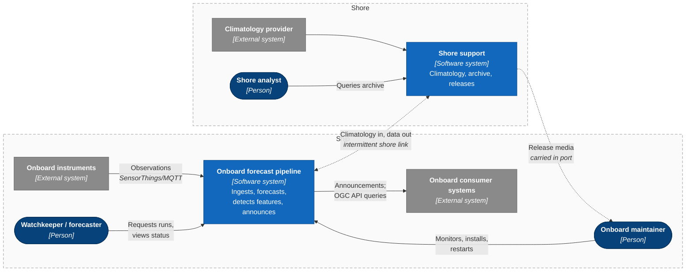

---

## 3. Level 2 — Containers

### 3.1 Onboard forecast pipeline

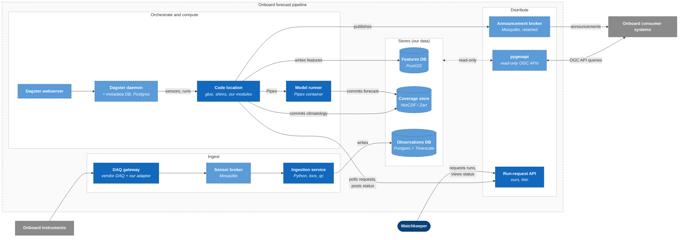

Only the main data relations are drawn. Every service also pulls its image from the onboard registry and exports metrics and logs to observability. Those relations are omitted for legibility.

The operations and shore-transfer containers are in §3.2. Two consequences of the Q1–Q3 decisions show across both diagrams:

- **The watchkeeper never reaches the enclave.** They use the run-request API in the distribution zone. The code location polls it (D1). The Dagster webserver remains, for the maintainer, on an enclave console.
- **The shore sync agent writes no store.** It only moves files between the shore link and the transfer area. The orchestrator owns both directions: the `climatology` asset imports from the inbox, and a `shore_export` asset writes bundles to the outbox (D2, D3).

### 3.2 Onboard pipeline — operations and shore transfer

The same system, showing only the containers that operate it and move data to and from shore.

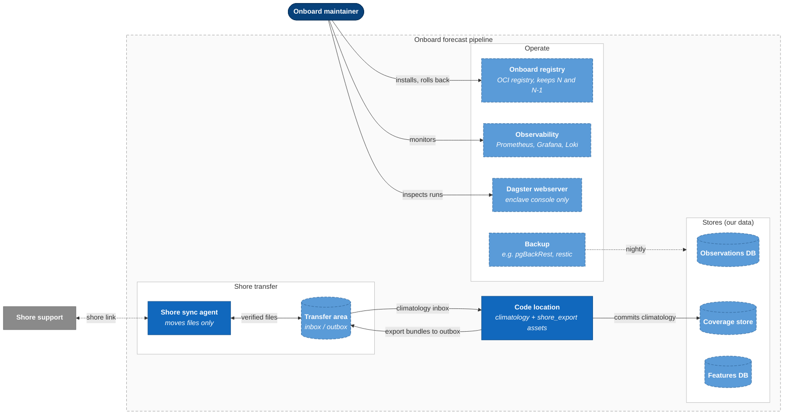

### 3.3 Shore support

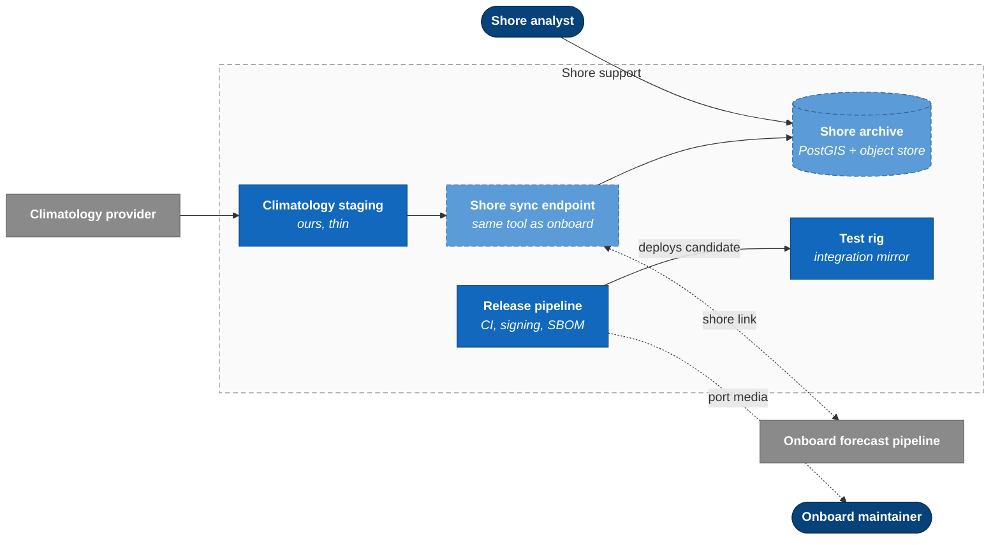

---

## 4. Level 3 — Components of the code location

### 4.1 Forecast pipeline components

This diagram is where the import boundary meets the process boundary (`system-architecture.md` §1.4 point 1). Everything below runs in **one process**. The model runner is the only module of ours that is isolated in its own process.

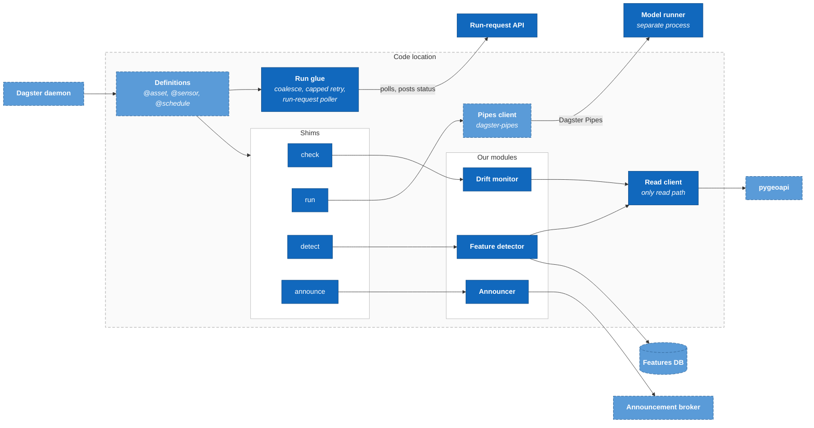

### 4.2 Shore transfer components

The same process, showing the two components added by D2 and D3. Each has its own shim, following ARC-2.

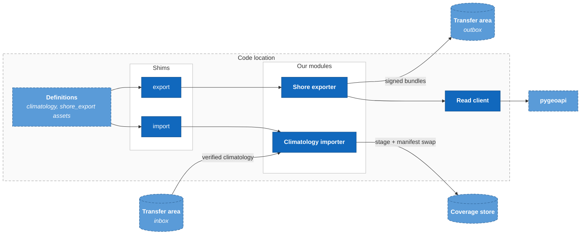

Boundary rules (ARC-1, ARC-7): the drift monitor, feature detector, announcer, shore exporter and climatology importer import neither Dagster nor the shims nor the deployment model. The run glue and the Pipes client are **orchestrator glue**. They are custom code, but they are neither our special sauce nor off the shelf, and they need an owner (`system-architecture.md` §5.3).

---

## 5. Dynamic diagrams

Drawn as sequence diagrams, with numbered steps. A sequence diagram shows order better than C4's numbered-arrow form.

### 5.1 Drift → forecast → announce

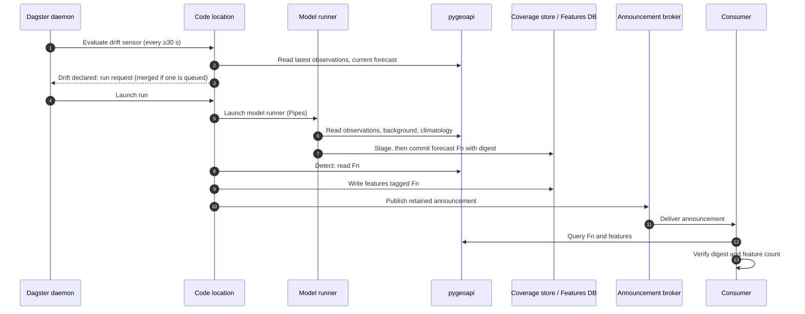

A step that fails (5–9) is retried with backoff, up to a cap. After that an alert is raised, and the staleness schedule becomes the recovery path (`system-architecture.md` §1.4 point 4).

### 5.2 Ingest outage recovery

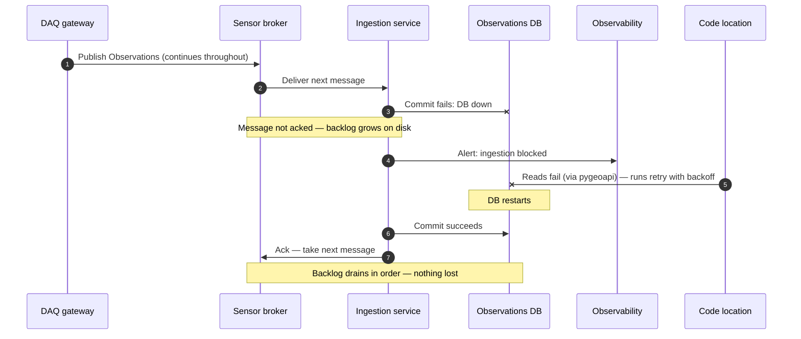

Step 5 is drawn as a direct call for brevity. The real path goes through pygeoapi. The sensor broker's disk must hold the longest DB outage you expect (`system-architecture.md` §1.3).

### 5.3 Late-joiner consumer

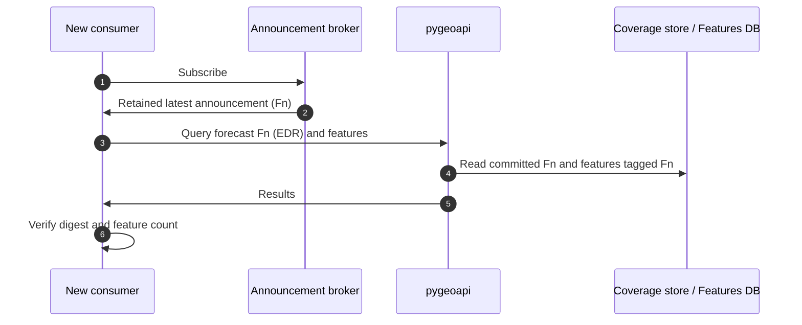

---

## 6. Deployment diagrams (the physical view)

### 6.1 Ship — production

The deployment nodes are **logical** (C4). Nodes in the processing enclave may share physical hosts, so the diagram does not size or count servers. Container runtime: Docker Compose or k3s on hardened hosts (A4).

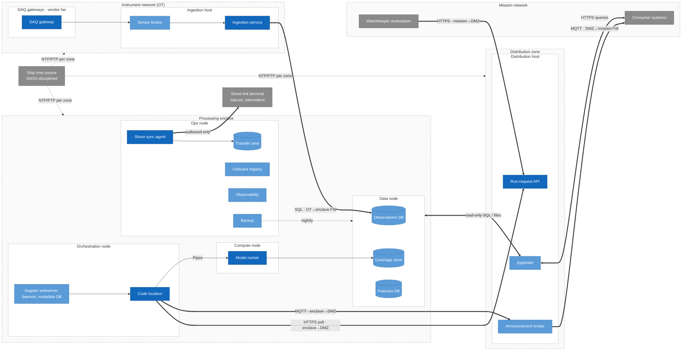

Firewall rules implied by the diagram. Each one should become a test on the test rig (§6.3):

| From → to | Allowed | Purpose |
|---|---|---|
| OT → enclave | Ingestion → Observations DB (SQL) only | Single writer |
| Enclave → OT | None | OT accepts no inbound (A2) |
| Enclave ↔ DMZ | Code location/model runner → pygeoapi; code location → broker; code location → run-request API (poll); pygeoapi → stores (read-only) | Single read path; enclave-initiated requests |
| DMZ → mission | Broker → consumers; consumers → pygeoapi (inbound to DMZ) | Distribution |
| Mission → DMZ | Watchkeeper → run-request API (HTTPS, authenticated) | Run requests and status (D1) |
| Mission → enclave | **None** | Zone model holds (D1) |
| Enclave → shore link | Shore sync agent only, outbound | Data out, climatology in |
| Time | Each zone's NTP/PTP server ← ship time source | Timestamps are a correctness dependency (D7) |

### 6.2 Shore

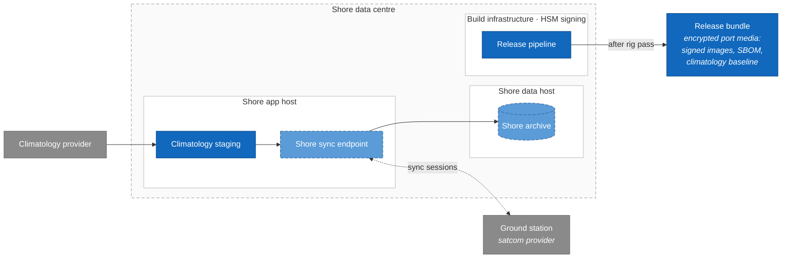

### 6.3 Shore test rig — integration mirror

The test rig has the same zones and the same container set as the ship, on smaller hardware. Two things differ:

- A **sensor replayer** replaces the instruments and DAQ gateways. It publishes recorded or synthetic SensorThings messages to the sensor broker.
- A **consumer simulator** replaces the mission systems. It subscribes, queries and verifies (CON-1–3).

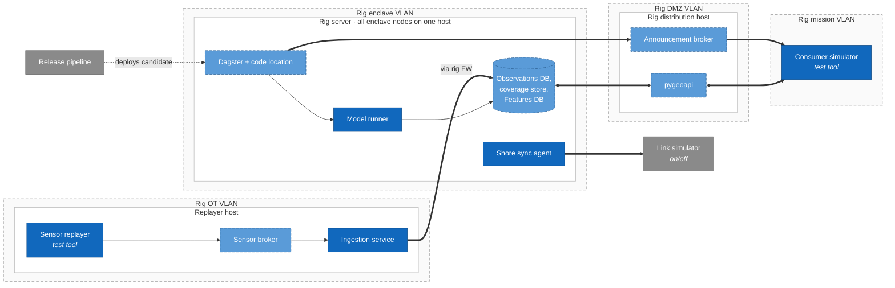

What the rig proves: the release images start; a sizing benchmark sets the onboard host count (D4); rollback from N to N-1 works with the release's schema migrations (D6); the firewall rules in §6.1 hold (including negative tests); the dynamic flows in §5 work end to end, including DB and ingestion restarts; and shore sync works against a link simulator that can be switched on and off.

What it does not prove: real instrument protocols and the DAQ adapter, production-scale performance, or hardware failover.

---

## 7. Decisions on the open questions (Nov 14, 2026)

| # | Question | Decision |
|---|---|---|
| D1 | **Q1 — Watchkeeper access.** The watchkeeper is on the mission network; the Dagster webserver is in the enclave. | A thin **run-request API** of ours in the distribution zone. The watchkeeper requests runs and sees status there. **The enclave pulls:** a Dagster sensor polls the API for pending requests and posts run status back. No mission → enclave or DMZ → enclave rule is added. Manual requests wait up to one sensor interval (≥30 s), and they merge with drift and staleness requests through the existing coalescing logic (ORC-2). The Dagster webserver stays enclave-only, for the maintainer. |
| D2 | **Q2 — Data back to shore.** | **Export bundles** produced by a new `shore_export` Dagster asset on a schedule, downstream of forecast and features. It reads through pygeoapi (the single read path holds) via a new `export` shim and writes signed, time-sliced bundles to the outbox. The shore sync agent only ships what is in the outbox. |
| D3 | **Q3 — Climatology commit.** | **Inbox + asset.** The sync agent verifies incoming climatology and drops it in the inbox. The existing `climatology` asset materialises from the inbox via a new `import` shim, using the same stage + manifest-swap commit as forecasts. One run at a time means it never swaps mid-run. The sync agent writes no store. |
| D4 | **Q4 — Host sizing.** | **Measure, then decide.** Nodes stay logical. A rig benchmark (realistic grid size, 6 inputs, backlog drain after an outage, export catch-up after a long link outage) sets the host count, at a gate before hardware procurement. |
| D5 | **Q5 — Urgent fixes.** | **Port media only, no exceptions.** Risk accepted: a critical fix can wait until the next port call. Mitigation is pre-release hardening on the rig and the rollback in D6. |
| D6 | **Q6 — Rollback.** | The onboard registry keeps **N and N-1**. A release is one manifest that pins every image. Rollback is **one documented command** that redeploys N-1. Schema migrations must stay backward-compatible for one release; the rig tests N → N-1 on every release. |
| D7 | **Q7 — Time and backup.** | **Both drawn** (§6.1). Time: the ship's GNSS-disciplined source feeds an NTP/PTP server in each zone. DAQ gateways timestamp at source; ingestion rejects observations with implausible clock skew. Backup: nightly local backup of the databases and coverage store to the ops node; the shore export bundles (D2) are the off-ship copy. |

New items these decisions add: the run-request API, the transfer area, the backup service, the `export` and `import` shims, and the shore exporter and climatology importer modules. None is in the SRD; the demonstrator does not need them.

---

## 8. Critical analysis

- **The physical view is still mostly logical.** Unsized deployment nodes (C4) make the diagrams honest, but they defer the decision a physical view usually exists to make: how many boxes, and what shares a host. D4 turns that into a measured gate, but until the rig benchmark runs, the ship deployment is not stable.
- **New containers expand scope.** The shore sync agent, transfer area, run-request API, backup, onboard registry, shore support system and test rig are not in the SRD. Each needs an owner. The sync agent is still the only container in the enclave that talks to the outside world, but D2/D3 shrink it to a file mover with no store access, which is the strongest position for a security review.
- **Read-path tension resolved, at a cost.** D2 and D3 route both shore flows through the orchestrator, so pygeoapi stays the only read path and the model runner and climatology importer are the only coverage-store writers. The cost: two more assets and shims, and export catch-up after a long link outage loads pygeoapi. The rig benchmark (D4) should measure that.
- **The run-request API is a new attack surface on the DMZ.** D1 keeps mission traffic out of the enclave, but the API accepts input from the mission network and its requests start runs. It needs authentication, rate limiting and a strict request schema. Polling adds up to one sensor interval of latency to manual requests; it may surprise watchkeepers used to an immediate response.
- **Mermaid flowcharts are a compromise.** They render on GitHub and lay out far better than Mermaid's C4 mode, but the C4 semantics live only in styling conventions, not in the notation. Some relations are omitted, or drawn to a whole group, to keep the diagrams legible. There is also no single model: the eight diagrams are maintained by hand and can drift from each other, from `system-architecture.md` §1.2 and from `deployment.ts`. If this document is chosen over §1.2, consider Structurizr DSL, or a test that checks container names against `deployment.ts` placements.
- **Naming differs from `deployment.ts`.** "Ops node" and "Shore link gateway" do not exist in the demonstrator, and the demonstrator's "Sea" zone has no production meaning. That is acceptable while the documents are compared, but must be reconciled afterwards.
- **Port media only (D5) puts weight on the rig and on rollback.** With no emergency path, a defect found at sea is lived with or rolled back. D6's N-1 rollback is the only remedy, so its rig test must not be skipped.
- **The test rig's blind spot is the edge that fails most.** The replayer bypasses the DAQ adapter and instrument protocols, which are often the least reliable parts at sea. A small bench of real instruments, or vendor simulators, would close that gap.
- **The "ours" vs "adopted" line is clearer here than in the SRD.** The technology field names the product and licence for every adopted container, so licence traps (TimescaleDB edition, PostGIS GPL, avoiding MinIO's AGPL) are visible on the diagrams themselves.
