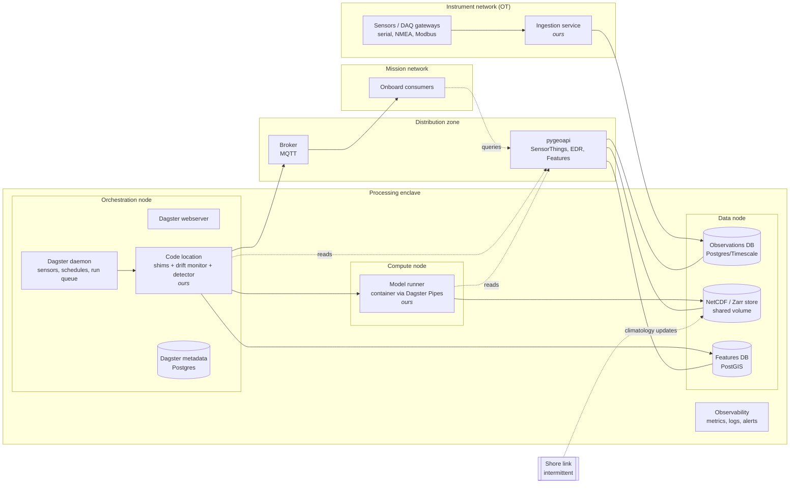

# System Architecture — Production Candidate and Demonstrator View

Companion to `srd.md` (v2). Status: **reviewed; requirements folded into `srd.md` (ARC-7, §5.6 SYS-1–6, acceptance 13–15)**. Nothing here is a committed deployment design; it exists so the demonstrator can show a credible one and so its gaps are visible early.

Three parts:

1. A candidate **production architecture** for the onboard pipeline.
2. How the demonstrator **employs or mocks** that architecture without breaking the SRD's aspirations.
3. An optional **system-architecture view** in the demonstrator, alongside the standard information-flow view.

---

## 1. Candidate production architecture

### 1.1 Assumptions

| # | Assumption | If wrong |
|---|---|---|
| A1 | Runs on the ship, on a small number of rack servers; must work with the shore link down. | A shore-hosted variant moves compute ashore; the zone model still holds. |
| A2 | Instruments sit on an operational-technology (OT) network that must not accept inbound traffic from mission systems. **Confirmed.** | Ingestion can be merged into the processing enclave. |
| A3 | Consumers are other onboard systems on a separate mission network. **Confirmed.** | Broker and pygeoapi move into the consumer zone. |
| A4 | Containerised deployment (Docker Compose or k3s) on hardened hosts. | Bare-metal services; nothing else changes. |

### 1.2 Zones and nodes



### 1.3 Mapping SRD elements to production components

| SRD element | Production component | Node / zone | Notes |
|---|---|---|---|
| Sensors | Instruments + DAQ gateways | OT | Gateways normalise serial/NMEA to a single message format. |
| Ingestion | Long-running service | OT (edge of) | Only writer to Observations DB. Not orchestrated (UI-4) — correct in production too: per-sample work does not belong in a batch orchestrator. |
| Orchestrator | Dagster webserver + daemon + metadata Postgres | Orchestration node | The "private store" (§2) is Dagster's own Postgres. |
| Shims | `@asset` / `@sensor` definitions | Code location process | See §1.4 — the boundary is an import boundary, not a process boundary. |
| Drift monitor, feature detector | Python packages imported by the code location | Orchestration node | Run in-process with the shims. |
| Model runner | Container launched by Dagster Pipes | Compute node | Heavier, may be a different language/runtime; isolate it. |
| Observations DB | Postgres + TimescaleDB | Data node | |
| NetCDF store | Shared volume (NFS) or MinIO with Zarr | Data node | Atomic commit = write to staging path, then rename/manifest swap. |
| Features DB | PostGIS | Data node | |
| pygeoapi | Container behind reverse proxy | Distribution zone | Read-only DB role. |
| Broker | Mosquitto (MQTT) | Distribution zone | Retained messages give late-joiner catch-up (CON-2) for free. |
| Consumers | Other onboard systems | Mission network | |
| *(not in SRD)* | Observability stack, time sync (PTP/NTP), backup, shore link | Processing enclave | Needed in production; out of demonstrator scope except the shore link (see §2.4). |

### 1.4 Critical analysis — where the SRD model and a real Dagster deployment diverge

These are the points a reviewer should challenge before the demonstrator presents this as "how it would work".

1. **The module boundary is not a process boundary.** In Dagster, shims and our modules run in the same code-location process. "Replaceable orchestrator" (SRD §1.2) holds at the *import* level only. Using Dagster Pipes for the model runner gives a real process boundary for the one module where it matters most; the others stay in-process. The demonstrator should not imply more isolation than this.
2. **A 4 s drift sensor is atypical for Dagster.** Sensors default to a 30 s minimum interval, and each evaluation has daemon overhead. Options: (a) accept a longer interval in production and treat 4 s as demo time-compression; (b) move drift scoring into an always-on service beside ingestion that *requests* runs via the Dagster API. Option (b) moves the drift monitor out of the orchestrator, which changes the SRD's "embedded in the sensor" picture. **Decided: (a).** Production keeps the Dagster sensor at ≥30 s; 4 s is demo time-compression.
3. **"Queue, then merge" is not native.** Dagster's run queue with a concurrency limit of 1 gives one-at-a-time, but merging queued requests (ORC-2) needs custom logic (a sensor that coalesces requests, or `run_key` dedupe plus cause tags). The shim is then more than a one-line pass-through (ARC-2); the extra logic belongs in orchestrator glue, not in our modules.
4. **"Retry until success" is unsafe in production.** Dagster `RetryPolicy` supports exponential backoff but needs a `max_retries`. Production should cap retries and raise an alert; the forecast staleness schedule then becomes the recovery path. The demonstrator can keep unbounded retry but should state that it is a demo simplification.
5. **pygeoapi as the only read path for our own modules** keeps the read path uniform but puts an HTTP hop (and EDR serialisation) in the model runner's hot path. Acceptable for small grids; for large coverages, allow direct read-only access to the NetCDF/Zarr store and keep pygeoapi for consumers. **Decided: pygeoapi only for now**; revisit if grids grow.
6. **Two schedulers of truth.** Ingestion runs continuously; Dagster sees observations only as a source asset. Asset freshness must therefore come from observation timestamps (an observable source asset), not from Dagster materialisation events.
7. **Shore link is absent from the SRD** but is the most likely production failure mode (stale climatology, no shore backup). Worth one line in the demonstrator; not worth simulating in v2.

---

## 2. Employing the architecture in the demonstrator

### 2.1 Principle

The system-architecture view is a **projection** of the same simulation, not a second simulation. It adds declarations, not behaviour. This keeps ARC-4 (render never mutates) and ARC-5 (replay digests) intact: switching view cannot change the event log.

### 2.2 Declaring deployment (extends ARC-3)

Each element already declares its relations. It also declares where it is deployed:

```ts
// sim/topology/deployment.ts — imported by the view layer only
export const zones = {
  ot:       { label: 'Instrument network (OT)' },
  proc:     { label: 'Processing enclave' },
  dmz:      { label: 'Distribution zone' },
  mission:  { label: 'Mission network' },
} as const;

export const nodes = {
  daq:      { zone: 'ot',      label: 'DAQ gateways' },
  ingest:   { zone: 'ot',      label: 'Ingestion host' },
  orch:     { zone: 'proc',    label: 'Orchestration node', offTheShelf: true },
  compute:  { zone: 'proc',    label: 'Compute node' },
  data:     { zone: 'proc',    label: 'Data node' },
  dist:     { zone: 'dmz',     label: 'Distribution host' },
  mission:  { zone: 'mission', label: 'Consumer hosts' },
} as const;

export const placement: Record<ElementId, { node: NodeId; process: string }> = {
  ingestion:     { node: 'ingest',  process: 'ingest-svc' },
  driftMonitor:  { node: 'orch',    process: 'code-location' },
  shimCheck:     { node: 'orch',    process: 'code-location' },
  modelRunner:   { node: 'compute', process: 'model-runner (Pipes)' },
  // …every element must be placed; a test enforces this
};

export const links = [
  { from: 'ingest', to: 'data', via: 'OT→enclave firewall' },
  { from: 'orch',   to: 'compute' },
  // …
];
```

Rules:

- Deployment data lives in the topology layer. Our modules do not import it (add it to the ARC-1 restricted list).
- Every element has exactly one placement; every derived edge between elements on different nodes must map to a declared link. Both are unit-tested, so the deployment model cannot silently drift from the information-flow model.
- Edges within one process are drawn as in-process calls; between processes on one node as local IPC; between nodes along the declared link.

### 2.3 Re-projecting tokens

SIM-6 token records `{edge, start, duration, retry?}` are unchanged. The system view resolves each `edge` to a route (element → process → node → link → node → process → element) and animates the same token along it. One sim interaction is still one token (MOT-1). No new token kinds.

### 2.4 Mocking infrastructure — what to add, what not to

| Candidate | Recommendation | Reason |
|---|---|---|
| Show orchestrator internals (webserver, daemon, code location, metadata DB) as boxes on the orchestration node | **Yes** | Answers SRD open question 4 in the system view only; it is the honest picture of §1.4 point 1. |
| Node health derived from existing faults (model runner offline → compute node red halo) | **Yes** | No new sim state; same colour meaning (MOT-5). |
| Static "shore link: not simulated" annotation | **Yes** | Makes the gap visible without scope creep. |
| New node-level faults (node down, link down, broker down) | **Defer** | Changes the simulation, needs new requirements, acceptance tests and golden digests. Revisit after v2. |
| Latency/bandwidth on links | **No** | Illustrative numerics would read as measured performance. |
| Realistic Dagster timings (30 s sensor etc.) | **No** | Breaks the tuned demo pacing; state the compression in the banner instead. |

---

## 3. The optional system-architecture view

### 3.1 Behaviour

- **Default view is information flow** (as specified in the SRD). The system view is opened from a presenter toolbar toggle, `View: Information flow | System`, and via `?view=system` for rehearsal.
- Switching view never pauses, resets or reseeds the simulation.
- Same clock, same tokens, same banner, same event log panel and controls.
- Banner adds: "Deployment is a candidate design, not a commitment. Timings are compressed."

### 3.2 Layout

Zones are vertical bands, left to right, deliberately mirroring the information-flow regions so the audience keeps their bearings:

| Info-flow region | System-view zone(s) |
|---|---|
| World | Instrument network (OT) |
| System | Processing enclave (orchestration, compute, data nodes) |
| System–Consumers boundary (broker straddles) | Distribution zone (pygeoapi, broker) |
| Onboard consumers | Mission network |

Within each node, processes are boxes; within each process, the elements placed there (so drift monitor, shims and detector visibly share the code-location process; the model runner is visibly separate).

### 3.3 Visual rules (consistent with SRD §5.3)

- Our software: steel accent, pale fill — same as info-flow view.
- Off-the-shelf processes: dashed border. Our stores: double border.
- **Zone boundaries are a new visual element** and must not reuse an existing colour: use neutral heavy rules with labels.
- Retry (amber), offline (red halo), materialising (green) keep their meanings; materialising applies to the store that received the write, since assets are not drawn in this view.
- Hovering an element highlights the same element in a small inset of the other view, so the two views are visibly the same system.
- Must fit 1280×720 without scrolling (UI-6) and be tested in its longest states (MR offline + DET retry + 6 inputs).

### 3.4 Critical analysis of the optional view

- **It works against "the logic is the layout".** In the system view the asset graph is not visible, so the *why* (triggers, lineage) is hidden behind the *where*. That is why it is optional and not default; the presenter should use it only after the info-flow walkthrough.
- **It risks reading as a commitment.** The banner caveat and §1.4 decisions mitigate this; the open decisions should be resolved, or shown as open, before external audiences see it.
- **It doubles the layout-maintenance burden.** Mitigated by deriving routes from declarations and by the placement/link completeness tests; still, every new element now needs two placements.
- **Token density is higher** (one interaction may cross 3–4 hops). Keep the MOT-1 minimum duration per *whole route*, not per hop, so 60× stays legible.

---

## 4. SRD additions

Now folded into `srd.md` (ARC-7 in §4, SYS-1–6 in §5.6). Kept here as the original proposal; `srd.md` is authoritative:

| ID | Requirement |
|---|---|
| ARC-7 | Each element declares a deployment placement (node, process); nodes declare a zone; inter-node links are declared. Tests assert every element is placed and every cross-node edge maps to a declared link. Our modules must not import the deployment model. |
| SYS-1 | A presenter toggle switches between the information-flow view (default) and the system-architecture view. Switching does not pause, reset or alter the simulation. |
| SYS-2 | The system view is a projection of the same token records (SIM-6); it introduces no new simulation events. |
| SYS-3 | Zones (OT, processing enclave, distribution, mission) are drawn left-to-right, mirroring World \| System \| Consumers. |
| SYS-4 | Orchestrator internals (webserver, daemon, code location, metadata DB) are shown; drift monitor, shims and detector sit in the code-location process; the model runner sits in its own process on the compute node. |
| SYS-5 | The banner states that the deployment is a candidate design and timings are compressed. |
| SYS-6 | The system view meets UI-6 (fits 1280×720) and the colour semantics of §5.3. |

Acceptance criteria:

13. Running the same seed and script with the view toggled at arbitrary ticks yields the same event-log digest as with no toggling.
14. With the model runner offline, the compute node shows the offline state and the run token's route ends at the orchestration→compute link with the amber retry on the shim.
15. Removing any element's placement, or a link required by a cross-node edge, fails the test suite.

Questions raised by this proposal, now decided (Nov 12, 2026):

- Drift cadence: Dagster sensor; ≥30 s in production, 4 s in the demo.
- Read path: pygeoapi only, for now.
- OT/mission network separation: confirmed.
